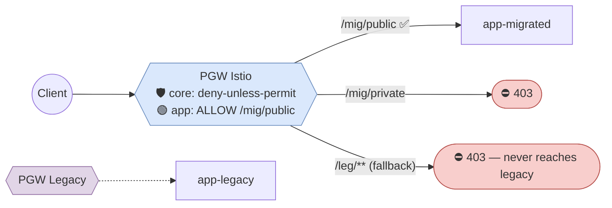
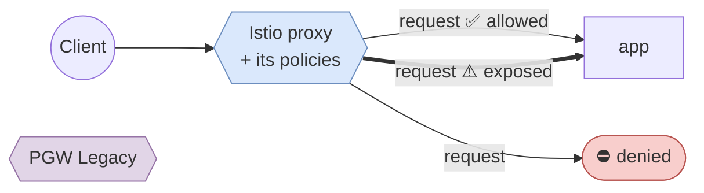
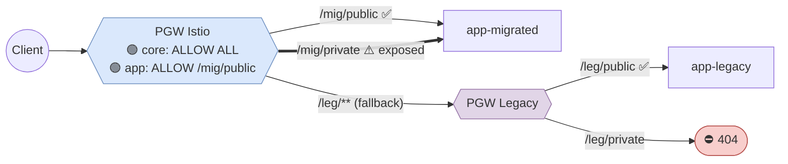
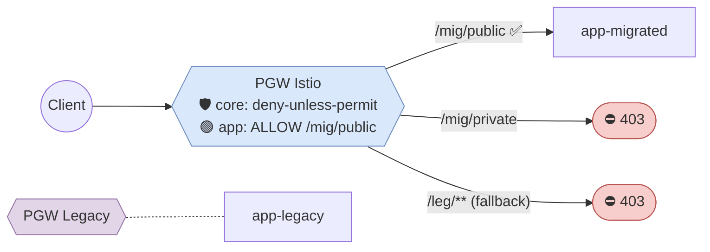
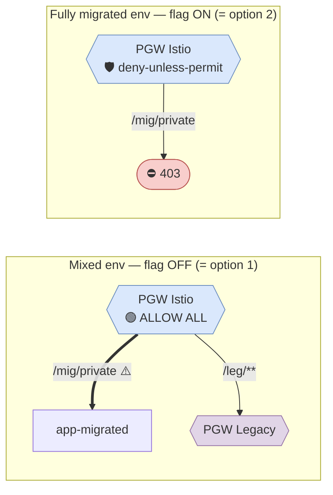
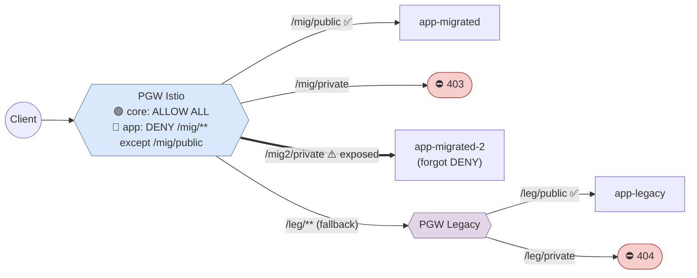
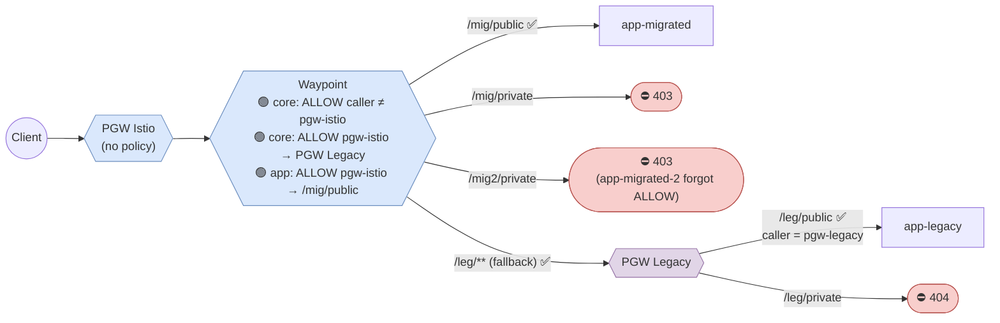
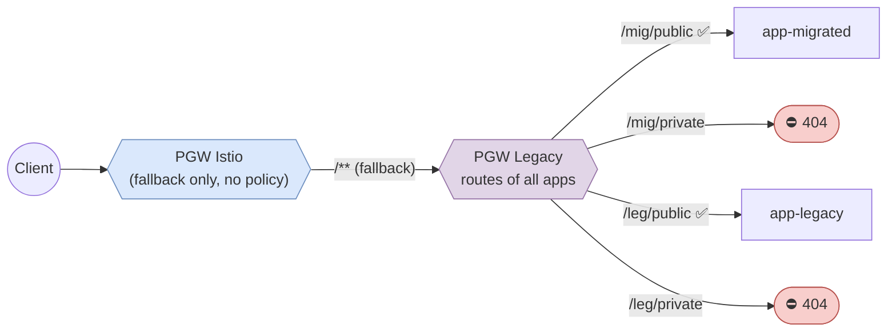
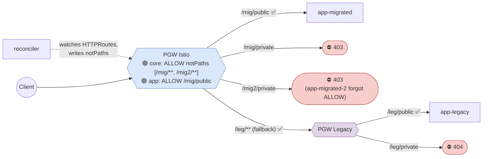
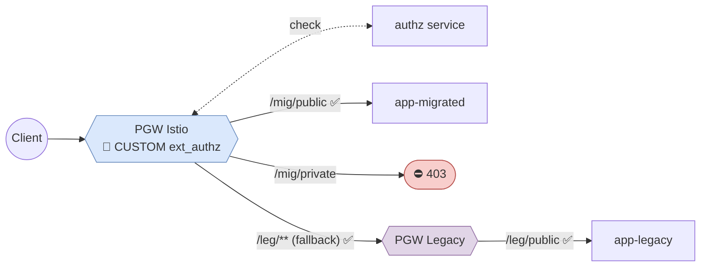

# Public Gateway Authorization During BWC Period: Options

Context: [allowed-and-forbidden-routes.md](allowed-and-forbidden-routes.md) proposes a deny-unless-permit AuthorizationPolicy on the Istio public gateway. During the BWC period, the Istio public gateway also has a fallback route to the legacy public gateway. This document compares the ways to combine the two.

Assumption: all apps, the legacy public gateway and the Istio public gateway live in **one namespace**.

## The Problem



* The gateway authz filter runs **before routing**. It sees only path, method, host, headers and caller identity, so it can't tell "fallback route" from "migrated route".
* If **any** ALLOW policy applies to a proxy, everything not matched by an ALLOW is denied. One app's ALLOW policy is enough to cut off the fallback.
* ALLOW policies are combined with **OR**. DENY always wins over ALLOW.

## Legend



* `app-migrated`: routes are in Istio HTTPRoutes. `/mig/public` is public; `/mig/private` must not be reachable via the public gateway.
* `app-migrated-2`: migrated, but **forgot** its AuthorizationPolicy. It shows whether an option is fail-safe.
* `app-legacy`: not migrated yet. Legacy gateway returns 404 for its non-public routes.
* All diagrams show **phase 2** (mixed state) unless stated otherwise. Phases come from [pgw-allowed.drawio.svg](../../pgw-allowed.drawio.svg):
  1. Install Core with Istio.
  2. Migrate apps one by one.
  3. Remove Legacy Core Mesh.

## Comparison

| Criterion | 1. Allow all | 2. Deny always | 3. Allow all + flag | 4. Allow all + app DENY | 5. Waypoint | 6. Public routes last | 7. Generated fallback allow | 8. ext_authz |
|---|:-:|:-:|:-:|:-:|:-:|:-:|:-:|:-:|
| Phase 1: non-migrated apps reachable | ✅ | ❌ | ✅ | ✅ | ✅ | ✅ | ✅ | ✅ |
| Phase 2: forbidden routes blocked on prod | ❌ | ✅ | ❌ | ✅ | ✅ | ✅ | ✅ | ✅ |
| Phase 2: forbidden routes testable | ❌ | ✅ | ⚠️ flag-on envs only | ✅ | ✅ | ✅ | ✅ | ✅ |
| Fail-safe if app forgets its policy | ❌ | ✅ | ❌ | ❌ | ✅ | ✅ | ✅ | ✅ |
| No new runtime component | ✅ | ✅ | ✅ | ✅ | ✅ | ✅ | ❌ controller | ❌ authz service |
| No extra hop / latency | ✅ | ✅ | ✅ | ✅ | ❌ waypoint | ⚠️ 2 gateways for public routes | ✅ | ❌ authz call |
| Project allow-more / deny-more with plain policies | ⚠️ deny only | ✅ | ⚠️ deny only | ⚠️ deny only | ✅ | ⚠️ legacy declarative config | ✅ | ⚠️ custom |
| No app rework at phase 3 | ✅ | ✅ | ✅ | ❌ DENY → ALLOW | ✅ | ❌ 2nd migration of public routes | ✅ | ❌ |

---

## Option 1. ALLOW ALL until Legacy Removal, then Deny-Unless-Permit

Core ships an ALLOW-all policy (`rules: [{}]`) and swaps it for deny-unless-permit in phase 3. Apps ship their final ALLOW policies right away.



| Pros | Cons |
|---|---|
| Trivial, nothing breaks in any phase | Phase 2: every route of migrated apps is public |
| App policies are final from day one | Forbidden routes can't be tested until phase 3 |
| | Acceptable only if phase 2 never happens on production |

## Option 2. Deny-Unless-Permit in All Phases



| Pros | Cons |
|---|---|
| Target security model from day one | Phase 1: **all** apps unreachable via public gateway until migrated |
| Simple, no BWC special cases | Defeats the purpose of the fallback |

## Option 3. Option 1 + Feature Flag

Same as option 1. A core-mesh-config parameter switches the public gateway to deny-unless-permit on environments where all public-facing apps are already migrated (CI, pre-prod, fully migrated prod).



| Pros | Cons |
|---|---|
| Cheap: one Helm parameter | Mixed environments still expose forbidden routes |
| Forbidden routes testable in flag-on envs | Pushes towards a big-bang production migration |

## Option 4. ALLOW ALL + per-App DENY

Each migrated app ships a DENY policy covering **its own route roots except its public paths**. A DENY policy only touches its own paths, so it can't affect other apps or the fallback.



App policy example

```yaml
apiVersion: security.istio.io/v1
kind: AuthorizationPolicy
metadata:
  name: mesh-app-public-deny
spec:
  targetRefs:
    - group: gateway.networking.k8s.io
      kind: Gateway
      name: public-gateway
  action: DENY
  rules:
    - to:
        - operation:
            paths: ["/api/v1/mesh-app-pub", "/api/v1/mesh-app-pub/*"]           # own HTTPRoute roots
            notPaths: ["/api/v1/mesh-app-pub/public/*", "/api/v1/mesh-app-pub/health"]  # public subset
```

| Pros                                             | Cons                                                                                                                                                                |
| ------------------------------------------------ | ------------------------------------------------------------------------------------------------------------------------------------------------------------------- |
| Forbidden routes blocked and testable in phase 2 | Fail-open: an app without its DENY is fully exposed                                                                                                                 |
| No controller, policies are static and per-app   | Project allow-more impossible with ALLOW (DENY wins); needs a Helm value to extend `notPaths`                                                                       |
|                                                  | Phase 3: apps rewrite DENY into ALLOW policies - otherwise we will not achieve deny-unless-permit for new microservices (by default everything new will be allowed) |

## Option 5. Enforce at the Waypoint

Migrated services are labeled `istio.io/ingress-use-waypoint: "true"`, so public gateway → app traffic passes the waypoint. Policies match on **who called**:

- Istio public gateway → only explicitly allowed paths.
- Anyone else (legacy gateways, private gateway, east-west) → allowed as before.

Fallback traffic reaches apps from the *legacy* gateway's identity, so it's untouched.



Policies example

```yaml
# core: everything that does not come from Istio public gateway is allowed as before
apiVersion: security.istio.io/v1
kind: AuthorizationPolicy
metadata:
  name: waypoint-allow-non-public-gateway
spec:
  targetRefs:
    - group: gateway.networking.k8s.io
      kind: Gateway
      name: waypoint
  action: ALLOW
  rules:
    - from:
        - source:
            notPrincipals: ["cluster.local/ns/<namespace>/sa/<pgw-istio-sa>"]
---
# core: Istio public gateway may always reach the legacy public gateway (fallback)
apiVersion: security.istio.io/v1
kind: AuthorizationPolicy
metadata:
  name: legacy-public-gateway-allow-fallback
spec:
  targetRefs:
    - group: ""
      kind: Service
      name: public-gateway-service
  action: ALLOW
  rules:
    - from:
        - source:
            principals: ["cluster.local/ns/<namespace>/sa/<pgw-istio-sa>"]
---
# app: public subset
apiVersion: security.istio.io/v1
kind: AuthorizationPolicy
metadata:
  name: mesh-app-public-allow
spec:
  targetRefs:
    - group: ""
      kind: Service
      name: mesh-app
  action: ALLOW
  rules:
    - from:
        - source:
            principals: ["cluster.local/ns/<namespace>/sa/<pgw-istio-sa>"]
      to:
        - operation:
            methods: ["GET"]
            paths: ["/api/v1/mesh-app-pub/public/*", "/api/v1/mesh-app-pub/health"]
```

| Pros | Cons |
|---|---|
| Deny-by-default for migrated apps in **all** phases | Extra waypoint hop for public traffic (latency, waypoint load) |
| Fail-safe: forgotten policy → 403, not exposure | Services that bypass the waypoint (e.g. headless) get only L4 checks → no path filtering |
| No controller; static per-app policies | Core "caller ≠ pgw-istio" ALLOW is OR-ed with any east-west ALLOW hardening on the same waypoint and neutralizes it |
| Same allow/deny model in phase 3, no rework | Paths are matched **after** gateway URL rewrite (backend path) |
| Project allow-more / deny-more = plain ALLOW / DENY policies | To validate in PoC: merging of Gateway- and Service-targeted policies, caller identity seen by waypoint |

## Option 6. Public Routes Migrate Last

During BWC, migrated apps keep registering their **public-gateway routes in the legacy mesh**, so the legacy gateway still returns 404 for forbidden routes. Their HTTPRoutes attach only to the private gateway and the waypoint. The Istio public gateway has only the fallback route and no policy. In phase 3, public routes move to HTTPRoutes together with deny-unless-permit.



| Pros | Cons |
|---|---|
| Zero security gap, legacy semantics (404) preserved | Apps carry legacy **and** Istio route config during BWC |
| No new policy model during BWC | Phase 3 needs a second migration step for public routes of every app |
| | Libraries/migration skill must keep registering public routes in `SERVICE_MESH_TYPE=Istio` mode |
| | Double gateway hop for all public traffic until phase 3 |

## Option 7. Generated Fallback ALLOW (Controller)

Core ships one ALLOW policy for the fallback: "everything **except** paths owned by migrated HTTPRoutes". A reconciler keeps the `notPaths` list in sync with the HTTPRoutes attached to the public gateway.



| Pros | Cons |
|---|---|
| Deny-by-default in all phases, no extra hop | New runtime component (controller) to build and operate |
| App policies are final from day one | Regex HTTPRoute matches only approximated (literal prefix + `*`) |
| Phase 3: delete one policy | Policy is briefly stale between HTTPRoute change and reconcile |

## Option 8. External Authorization (`action: CUSTOM`)

The public gateway asks an external authz service that knows which routes are migrated and which are public.



| Pros | Cons |
|---|---|
| Any logic possible | New runtime component on the hot path: latency, single point of failure |
| | Custom config format instead of standard AuthorizationPolicy |

---

## Rejected Ideas

* **Separate hostname for migrated APIs.** Breaks contract DNS names.
* **Per-app fallback ALLOW with** `notPaths`**.** ALLOW policies are OR-ed, so app A's policy allows app B's paths and the result is "allow everything".
* **Lua** `TrafficExtension` **marking requests before authz.** Lua runs in `STATS` phase, after authz, and would need the same path list as option 7.
